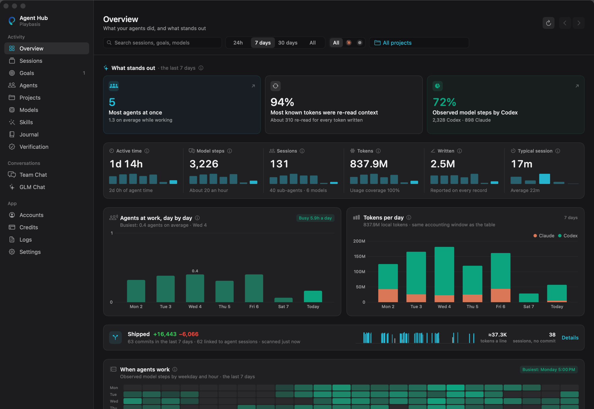
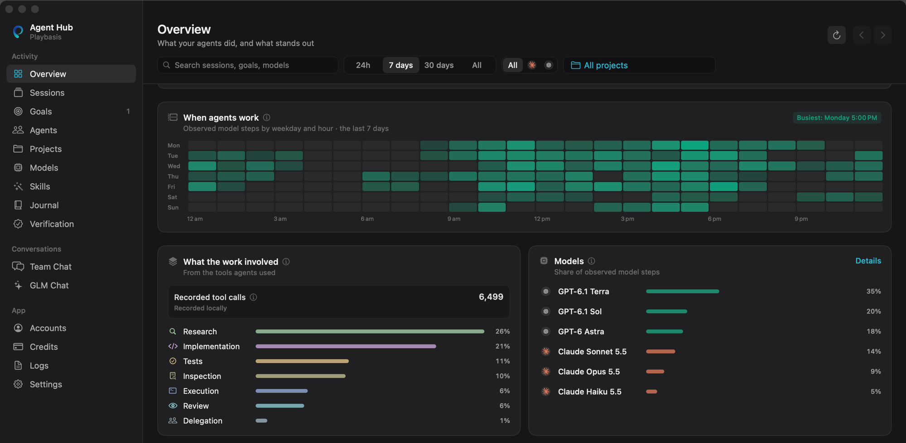
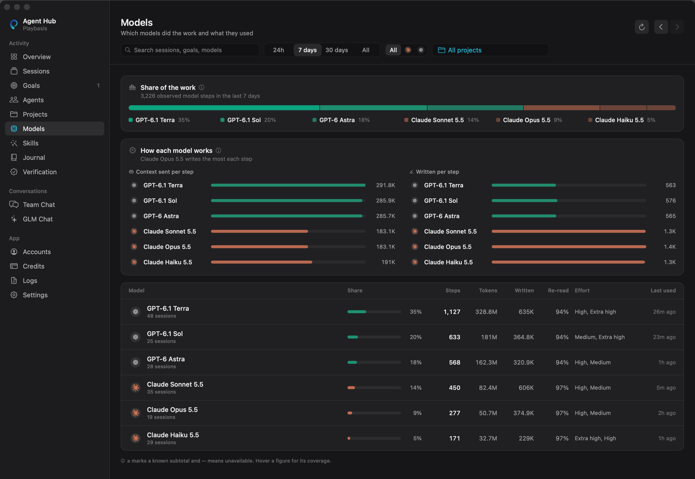
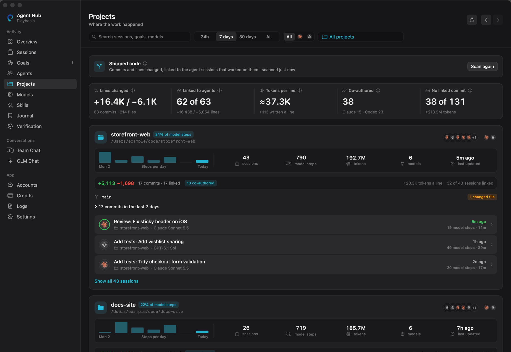
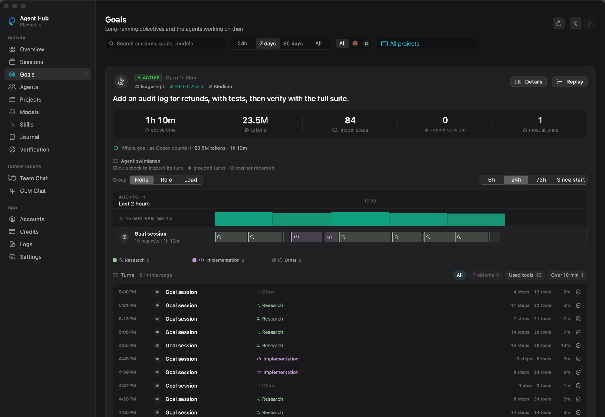
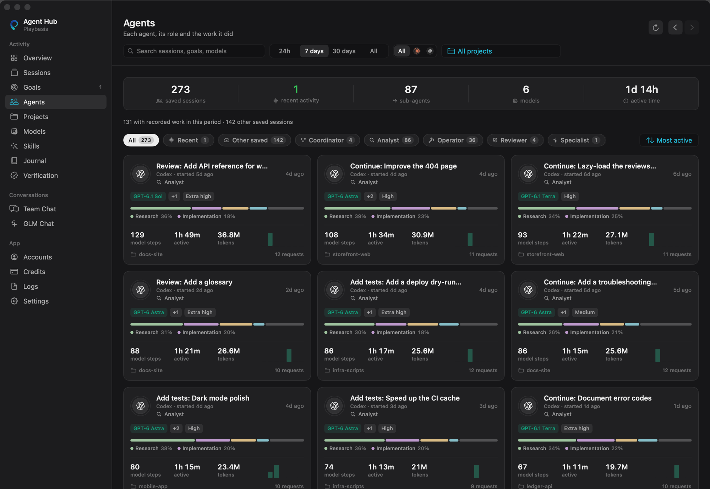

# Playbasis AI Agent Hub

**See what your Claude Code and Codex agents actually get done.**

Agent Hub is a native macOS companion for developers who code with
Anthropic's Claude Code, OpenAI's Codex, or both. It reads the sessions both
agents already keep on your Mac and turns them into a dashboard: where the
time and tokens went, which models and skills did the work, which commits
they shipped, and how fast you are using up your plan. Everything stays on
your Mac: no account to create, no server, and no API key needed.

> **Status: public preview (0.1).** Built from source, ad-hoc signed, not yet
> notarized. Open source under the [Apache License 2.0](LICENSE).



<sub>Every screenshot in this README is rendered from invented demo data, never a real history. Regenerate them with `make screenshots`.</sub>

## What you see

| Page | What it answers |
| --- | --- |
| **Overview** | How much got done today, this week or this month: active time, sessions, model steps and tokens, agents at work by day and by hour, where the tokens went (context re-read versus text written), what shipped, and highlights for anything surprising, such as a weekly limit on pace to run out before it resets. |
| **Sessions** | Every Claude Code and Codex session, live and past, side by side. Open any request to see its model, effort, tokens, tools, skills and sub-agents. |
| **Goals** | Each goal replayed as swimlanes across the sessions that worked on it, with the evidence of what it produced. |
| **Agents** | Every agent and sub-agent that worked, as a team roster. |
| **Projects** | Trends per project, and **shipped code**: commits linked to the sessions that wrote them (by co-author trailer, the same files, or timing), lines changed and tokens per line. |
| **Models** | Each model's share of the work, how it works (context sent and text written per step), and the effort levels you used. |
| **Skills** | Which skills each agent can load and actually loads, at what context cost, plus the instruction files every session started with (`AGENTS.md`, `CLAUDE.md`, rules and memory), with their history so you can see when they changed. |
| **Accounts and Credits** | Claude and ChatGPT plan limits and reset times as gauges, Codex credits kept separate from plan allowance, and credit history with cautious forecasts. |
| **Journal** | A daily brief of what your agents did, written from the day's records. |
| **Verification and Logs** | Per-request receipts (model, effort, tokens, tools), hash-chained so a later edit shows, and a searchable live log. |

The menu-bar panel keeps the essentials one click away: plan limits and
credits, with a warning when one is on pace to run out, your pinned goal,
today's totals and the agents at work.

### A closer look

**When your agents work, and what the work involved.** A weekday-by-hour heatmap, the mix of tools used, and each model's share of the steps.



**Which model did the work, and how each one behaves.** Share of the work, context sent and text written per step, effort levels and how much was re-read context.



**What shipped.** Commits linked to the sessions that wrote them, with lines changed, tokens per line and which commits were co-authored by an agent.



**Goals, replayed.** Each goal as swimlanes across the agents that worked on it, with every turn behind it.



**Every agent and sub-agent.** Who did what, in which project, with which model and effort.



## Numbers you can trust

- **Measured, not guessed.** Every figure comes from one versioned accounting
  pass in tested code. Missing data shows as "—", never as zero, and a total
  built from partial records is marked "≥".
- **Both agents counted the same way.** Claude Code and Codex sit side by side
  under the same definitions, so comparisons are fair.
- **The method is one click away.** Each card leads with the figure; how it
  was measured sits behind an ⓘ.
- **Fast on large histories.** Built and measured against hundreds of
  sessions and more than a hundred thousand model steps. Reports are prepared
  off the main thread, and the app sits near zero CPU when idle.

## Built for Claude Code and Codex

Agent Hub works with each agent through its own official CLI and files, the
way you would in a terminal. It never touches their credential files.

| | Claude Code (`claude`) | Codex (`codex`) |
| --- | --- | --- |
| **Session history** | Reads your transcripts in `~/.claude/projects` | Asks `codex app-server` for your threads and goals |
| **Each request** | Model, effort, tokens, tools, skills and sub-agents from the transcript | The same, from the thread and its rollout |
| **Skills and instructions** | Skill loads, `CLAUDE.md`, rules, imports and memory | `SKILL.md` reads and the `AGENTS.md` chain |
| **Plan limits** | Claude Code's own `/usage` | `codex app-server` rate limits and credits |
| **Sign in** | Runs `claude auth login` for you | Codex's own `app-server` sign-in (ChatGPT plans) |
| **Live events** | Optional hooks (`bridge install-hooks`) | From `codex exec --json` |

Either agent works on its own. Tested with Claude Code 2.1.258 and Codex CLI
0.145 on macOS 14.

## Also included

- **Team Room (experimental).** Hand a goal to a lead (Claude, Codex or
  Gemini), let Claude and Codex build it together, and keep every hand-off on
  record. See [Team Room](docs/TEAM-ROOM.md).
- **Economic reports** from the `bridge economics` command: what you spent,
  what work landed and the comparable human effort for a day, week, month or
  year, with every figure linked to its evidence and unknowns left unknown.
  See [Economic reporting](docs/ECONOMIC-REPORTING.md).
- **A local API and CLI**, so scripts can read the same reports as the app.
- **Optional extras**, off until you add them: a Gemini coordinator, a local
  Ollama router, and GLM Chat through your own DigitalOcean inference key.

## Who it is for

- **Developers and vibe coders using Claude Code, Codex, or both** who want to
  see how their agents turn tokens and plan allowance into working code.
- **Founders and small teams** who want to know what their agents actually
  shipped and what it cost in time and plan usage, without a hosted dashboard.
- **Anyone careful about privacy.** Agent Hub signs in through each provider's
  own CLI, never reads their credential files, and keeps its records local.

It is not a hosted service and it does not run on Windows or Linux. It
reports on your agents; it doesn't replace them.

## What you need

- A Mac on **macOS 13** or newer.
- **Xcode** or the **Xcode Command Line Tools** with Swift 5.9 or newer
  (`xcode-select --install`).
- **[Claude Code](https://code.claude.com/docs/en/overview)** and/or
  **[Codex CLI](https://github.com/openai/codex)**, installed.

## Install

```bash
git clone https://github.com/playbasis/agent-hub.git
cd agent-hub
make doctor                           # checks the list above; changes nothing
make install                          # builds the app and installs it in ~/Applications
make open
```

Its icon appears in the menu bar. Afterwards you can also open
**Playbasis AI Agent Hub** from Launchpad or Spotlight.

`make install` replaces an older copy only after checking the new one, and keeps
the old one as a backup. Because you build it yourself, macOS opens it without
a Gatekeeper warning.

## First five minutes

1. **Overview:** your existing Claude Code and Codex sessions appear straight
   away, and new work arrives as it happens.
2. **Accounts:** press **Link Claude** and/or **Link ChatGPT** to see plan
   limits. Skip this if your CLIs are already signed in.
3. **Projects:** press **Scan projects** to link commits to the sessions that
   wrote them.
4. **Skills:** check which skills and instruction files each agent is
   really using.

## Your keys and your data

- **No keys are shipped or required.** Claude and ChatGPT sign-in is handled by
  each provider's own CLI.
- **Optional keys** (Gemini, GLM, an OpenAI-compatible router) are saved in an
  owner-only file in Agent Hub's Application Support folder, or read from an
  environment variable you name. They are never written to `config.json`.
- **What it reads.** Nothing at startup. When you open the panel or the Hub, it
  reads your Claude Code transcripts in `~/.claude/projects` and asks Codex for
  its session list. It reads a project's Git history only when you press
  **Scan projects**, and works inside a project only after you choose it.
- **What it keeps.** Everything stays in
  `~/Library/Application Support/ClaudeCodexBridge`, readable only by you.
  Saved records hold session titles, goals, timings, models, token counts and
  changed file names, not your full prompts or tool output. Home-folder paths
  are redacted.
- **The local control service listens on this Mac only** (it refuses to start
  on any other address), and everything except a health check needs a token the
  app generates.
- **Agents keep their safety settings.** Agent Hub never adds either CLI's
  permission-bypass flags. Sessions it starts itself run Claude Code in safe
  mode and Codex with a workspace-write sandbox; Team Room uses the permission
  and sandbox settings you already chose for each CLI. Every run has a deadline
  and a timeout.

## Troubleshooting

| Problem | Fix |
| --- | --- |
| "Claude Code (or Codex CLI) is not installed or not on PATH" | Apps opened from Finder don't see your shell's PATH. Agent Hub looks in `~/.local/bin`, Homebrew, nvm, Volta, asdf, mise and Bun. For anywhere else, set the full path as `agents.claude_command` or `agents.codex_command` in `~/Library/Application Support/ClaudeCodexBridge/config.json` and reopen the app. |
| A Codex model isn't available on your plan | Change the Codex model in **Settings**, or per room in **Team setup**. |
| Port 8742 is already in use | Quit the other program, or change `server.port` in `config.json`. |
| Nothing happens when you open a second copy | Only one Agent Hub runs at a time. Quit the menu-bar copy first. |
| Anything else | Run `make doctor`, and look in **Logs** or `~/Library/Logs/ClaudeCodexBridge`. |

## Uninstall

```bash
make uninstall            # moves the app to the Trash; keeps your history and keys
make uninstall PURGE=1    # also moves history, keys, logs and preferences to the Trash
```

Claude Code, Codex and their sign-ins are left alone.

## For power users: the `bridge` command

The app ships a command-line helper at
`~/Applications/ClaudeCodexBridge.app/Contents/Helpers/bridge` (or
`apps/MenuBar/.build/debug/bridge` after `make build`).

```bash
bridge status                                   # what is running
bridge metrics view --window 24h                # saved activity, without the app
bridge install-hooks --project /path/to/project # send Claude Code hook events to the Hub
bridge start --project /path/to/project --goal "Build it, test it, stop when verified"
```

## Develop

```bash
make help      # every target
make check     # build + tests + the repository hygiene check
make preview PAGE=Models   # one Hub page in a window beside the installed app
make screenshots           # re-render docs/screenshots from invented demo data
make hooks     # run the hygiene check and gitleaks before every push
```

Read [CONTRIBUTING.md](CONTRIBUTING.md) and [AGENTS.md](AGENTS.md) before
changing behaviour. More detail:

- [Architecture](docs/ARCHITECTURE.md) and [why native Swift](docs/ADR-001-swift-native-core.md)
- [Team Room](docs/TEAM-ROOM.md)
- [Operations](docs/OPERATIONS.md) and [build recovery](docs/BUILD-RECOVERY.md)
- [Security model](docs/SECURITY.md); to report a problem, see [SECURITY.md](SECURITY.md)
- [Economic reporting](docs/ECONOMIC-REPORTING.md),
  [workspace receipt contract](docs/WORKSPACE-RECEIPT-CONTRACT.md) and
  [token allocation](docs/TOKEN-ALLOCATION-STRATEGY.md)

## Licence

Agent Hub is released under the [Apache License 2.0](LICENSE). The Playbasis
marks, the agent persona portraits and the provider logos are not covered; see
[NOTICE](NOTICE).

## Names

The product is **Playbasis AI Agent Hub**. Inside the code you will see its
codename, `ClaudeCodexBridge`. It is kept for the bundle identifier, data
folder and file names so existing installs upgrade in place.

Claude, Claude Code, Codex, ChatGPT, Gemini and the provider logos in this
repository belong to their owners and are used only to identify those services.
The Playbasis name and marks belong to Playbasis.
