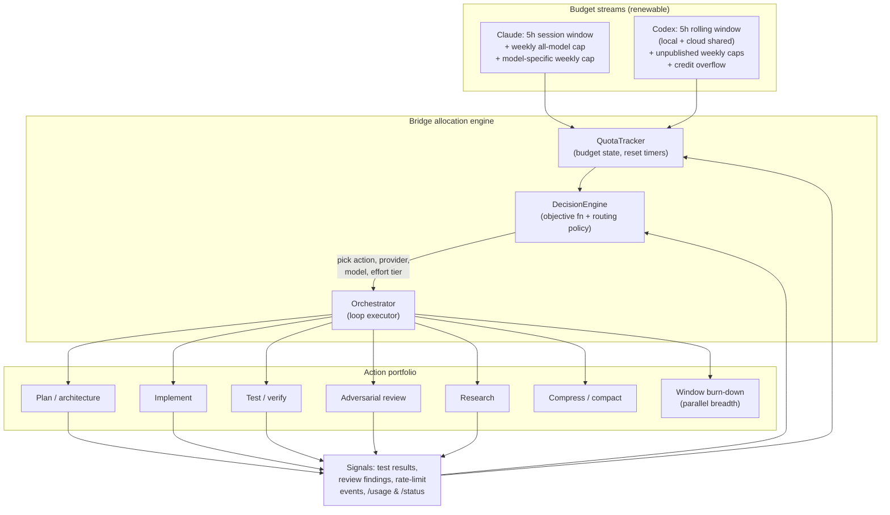
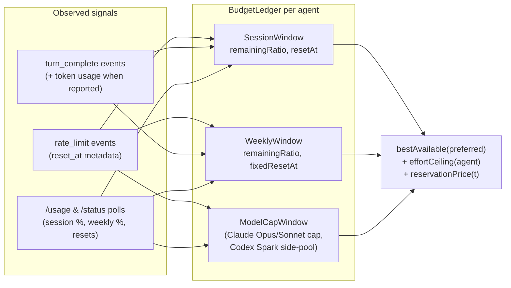
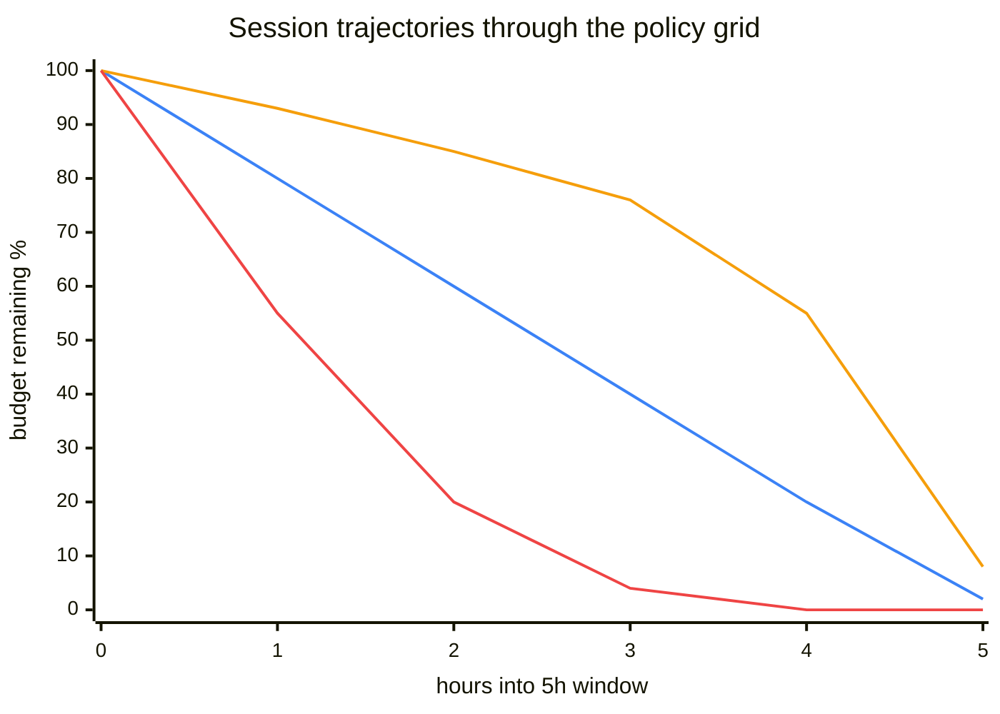
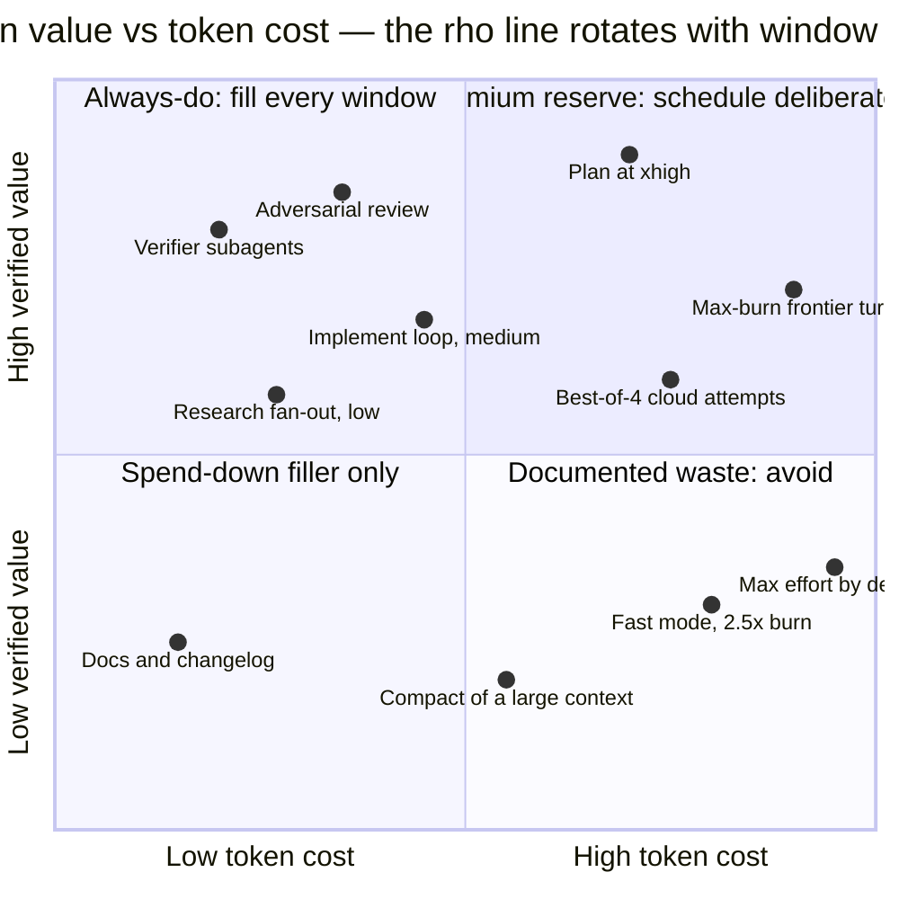
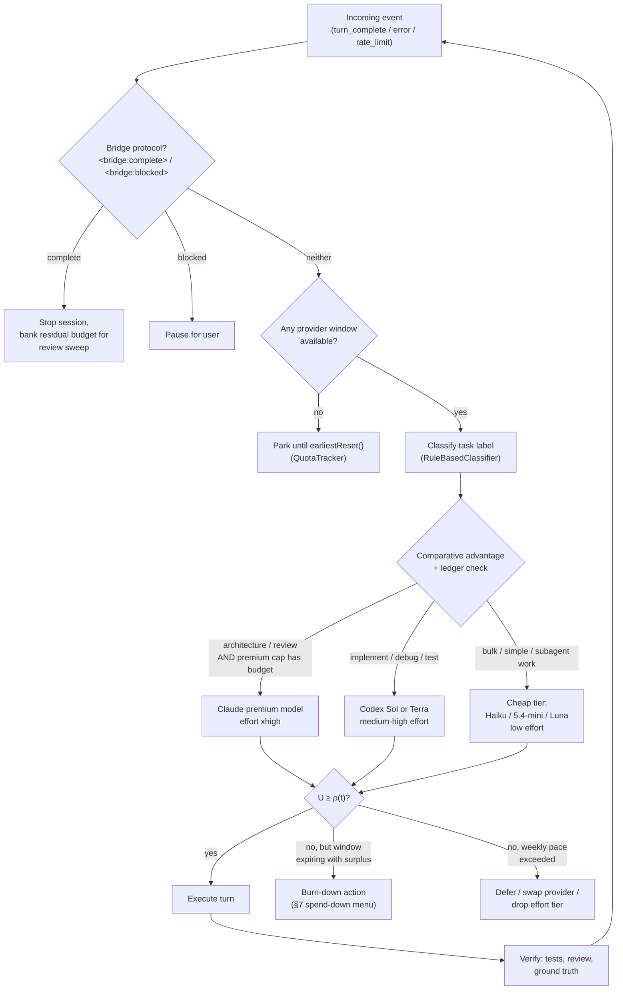
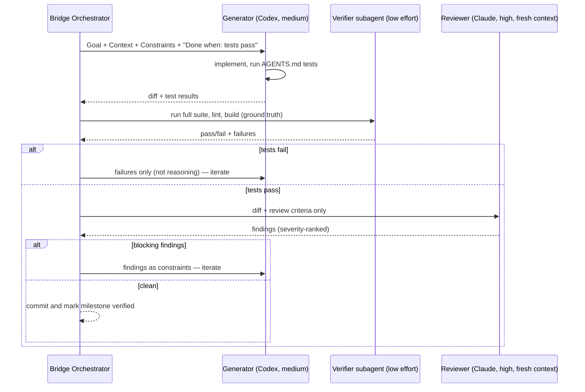
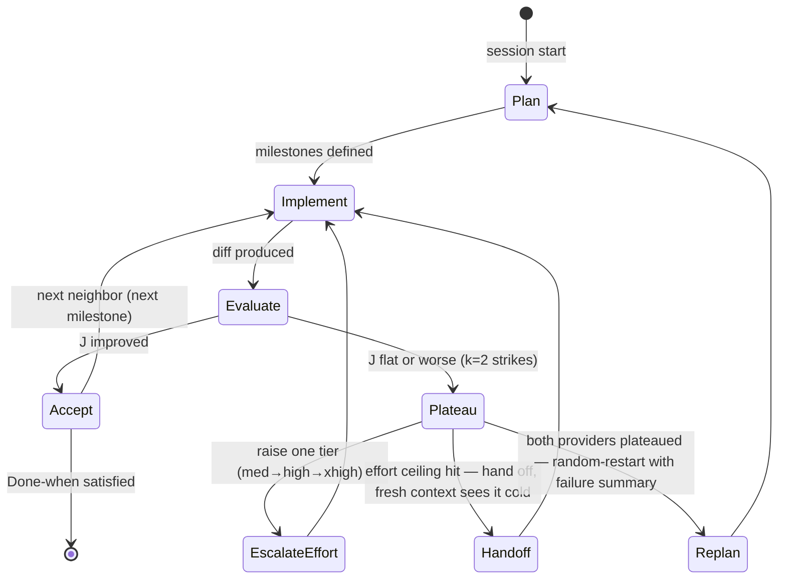
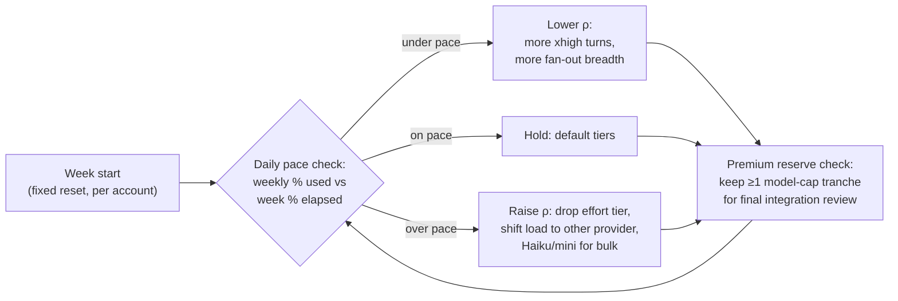

# Token Allocation Strategy

**Spending two subscriptions like a portfolio: trees, loops, and decisions for full-window utilization**

Research date: 2026-07-24. Every mechanic below cites the provider page it comes from; limits change often (both vendors' docs were updated within days of this research), so re-verify numbers at implementation time via `/usage` (Claude Code) and `/status` (Codex CLI). This document designs the allocation layer that sits above the bridge's existing `QuotaTracker`, `DecisionEngine`, and `Orchestrator` modules.

> **Scope note.** Everything here optimizes *paid allowances through officially documented levers* — effort settings, subagents, parallel attempts, scheduling around published reset windows. Nothing circumvents metering.

---

## 1. The system at a glance

The bridge treats the two accounts as two renewable budget streams and every model turn as a *position* it takes with that budget. Actions (plan, implement, test, adversarial review, compress, burn-down) have estimated costs and expected value; the decision engine routes each turn to the provider/model/effort tier with the best marginal value per unit of remaining budget.



The bridge's default autonomous session is **4 hours** (`durationMinutes = 240` in `BridgeViewModel`) run *inside* each provider's 5-hour window — the spare hour absorbs reset skew between the two providers and leaves margin for a spend-down phase (§7).

---

## 2. Ground truth: what the budgets actually are

### 2.1 Claude (Pro / Max) — session + weekly, token-threshold based

| Mechanic | Documented behavior | Source |
|---|---|---|
| Session window | "Your session-based usage limit will reset every five hours"; per-session amounts unpublished, varying with message length, attachments, conversation length, model, features | [Pro plan](https://support.claude.com/en/articles/8325606-what-is-the-pro-plan) |
| Window shape | Claude Code describes allowances resetting "on a rolling five-hour window and a weekly window"; shared with Claude chat/Desktop/Cowork | [Claude Code costs](https://code.claude.com/docs/en/costs) |
| 2026 doubling | May 6, 2026: five-hour limits permanently **doubled** on Pro/Max/Team/Enterprise; peak-hours reduction eliminated | [Anthropic news](https://www.anthropic.com/news/higher-limits-spacex) |
| Plan multipliers | Max 5x = "5 times more usage per session than Pro"; Max 20x = 20× Pro | [Max plan](https://support.claude.com/en/articles/11049741-what-is-the-max-plan) |
| Weekly caps | Reset at a **fixed per-account day/time** each week (visible in Settings → Usage). Pro: one all-model weekly cap. Max: two — all-model + a model-specific cap (current article says "Sonnet models only"; the best-practices article and Claude Code error docs still describe an **Opus-only** limit — docs are mid-transition, verify live) | [Max plan](https://support.claude.com/en/articles/11049741-what-is-the-max-plan), [best practices](https://support.claude.com/en/articles/9797557-usage-limit-best-practices), [CC errors](https://code.claude.com/docs/en/errors) |
| Model-cap escape hatch | "The Opus limit applies only to Opus requests" — `/model` to another model keeps you working; session/weekly limits are shared across all models, so switching does **not** restore those | [CC errors](https://code.claude.com/docs/en/errors) |
| Simultaneous accrual | "A single burst of heavy activity, such as a large workflow fanout, can exhaust the weekly allowance before the session window resets" | [CC errors](https://code.claude.com/docs/en/errors) |
| Frontier-model cap | Fable 5: max 50% of weekly limits on Max plans, burns limits faster than other models | [Fable 5 plan article](https://support.claude.com/en/articles/15424964-claude-fable-5-on-your-plan) |
| Overflow | Usage credits at API rates past included limits ($2,000/day redemption cap); 5h resets continue as usual | [Usage credits](https://support.claude.com/en/articles/12429409-manage-usage-credits-for-paid-claude-plans) |
| Observability | `/usage` shows session + weekly progress bars and per-feature attribution (subagents, skills, MCP servers ≥10% flagged); approximate and local-history based | [Claude Code costs](https://code.claude.com/docs/en/costs) |

**What burns Claude quota** (all [Claude Code costs](https://code.claude.com/docs/en/costs) unless noted):

- Thinking tokens **bill as output tokens**; default budgets can be tens of thousands per request. Effort is the control on current models.
- Full conversation is re-sent every message; prompt cache lives **1 hour on subscription** (5 min once on usage credits). A one-line question in a stale session pays for the whole history.
- `/compact` is itself a large request (it reads everything it summarizes); `/clear` costs nothing.
- Subagents count against the same pool; **agent teams ≈ 7× tokens** vs standard sessions.
- Mid-session `/model` switches force a full **uncached re-read** of history ([model config](https://code.claude.com/docs/en/model-config)).
- Changing effort mid-conversation **invalidates prompt caching** — hold effort constant within a session, vary it across sessions ([effort docs](https://platform.claude.com/docs/en/build-with-claude/effort)).

**Claude model economics** ([models overview](https://platform.claude.com/docs/en/about-claude/models/overview)): 1M-token context is now *standard* on Fable 5 / Opus 4.8–4.6 / Sonnet 5 / Sonnet 4.6 (Haiku 4.5: 200k). Max output 128k (Haiku/Sonnet 4.5: 64k). API price proxies for relative burn: Fable 5 $10/$50 per MTok in/out · Opus 4.8 $5/$25 · Sonnet 5 $3/$15 · Haiku 4.5 $1/$5 — i.e., **an Opus turn ≈ 1.7× a Sonnet turn ≈ 5× a Haiku turn** on output.

### 2.2 Codex (ChatGPT Plus / Pro) — one shared 5h credit pool

| Mechanic | Documented behavior | Source |
|---|---|---|
| Window shape | Per-model "local messages / rolling 5h window" ranges; **"local messages and cloud chats share a five-hour window. Additional weekly limits may apply"** (weekly numbers unpublished) | [Codex pricing](https://developers.openai.com/codex/pricing) |
| Plus (per 5h) | GPT-5.6 Sol 15–90 · Terra 20–110 · Luna 50–280 · 5.4-mini 60–350 msgs | [Codex pricing](https://developers.openai.com/codex/pricing) |
| Pro 5x (per 5h) | Sol 75–450 · Terra 100–550 · Luna 250–1400 · mini 300–1750 | [Codex pricing](https://developers.openai.com/codex/pricing) |
| Pro 20x (per 5h) | Sol 300–1800 · Terra 400–2200 · Luna 1000–5600 · mini 1200–7000 | [Codex pricing](https://developers.openai.com/codex/pricing) |
| Metering | Since Apr 2, 2026: token-based credit metering — credits per 1M input/cached/output tokens. Sol 125/12.5/750 · Terra 62.5/6.25/375 · Luna 25/2.5/150 · 5.4-mini 18.75/1.875/113. Typical Sol message: 5–40 credits | [Rate card](https://help.openai.com/en/articles/20001106-codex-rate-card) |
| Shared pool | Codex + ChatGPT Work + ChatGPT for Excel + Workspace Agents draw from **one** agentic pool | [Plan article](https://help.openai.com/en/articles/11369540-using-codex-with-your-chatgpt-plan) |
| Mid-turn grace | "If you reach your usage limits during an active turn, the agent will be able to continue working on that turn" — a turn already in flight finishes | [Codex pricing](https://developers.openai.com/codex/pricing#what-happens-when-you-hit-usage-limits) |
| Best-of-N | `codex cloud exec --attempts 1..4` (per-attempt billing no longer stated officially — treat as N× until verified) | [CLI reference](https://developers.openai.com/codex/cli/reference) |
| Fast mode | **Anti-lever for quota**: 1.5× speed at 2.5× credit burn (Sol/5.5), 2× (5.4) | [Speed docs](https://developers.openai.com/codex/speed) |
| Separate pools | GPT-5.3-Codex-Spark (Pro-only research preview) has its **own** usage limit — free breadth that doesn't touch the main pool | [Codex pricing](https://developers.openai.com/codex/pricing) |
| Model specs | GPT-5.6 Sol/Terra/Luna: 1.05M context, 128k max output; reasoning tokens billed as output, ≥25k headroom recommended | [Model card](https://platform.openai.com/docs/models/gpt-5.6-sol), [reasoning guide](https://developers.openai.com/api/docs/guides/reasoning) |
| Observability | `/status`, `/usage` in CLI; dashboard at chatgpt.com/codex/settings/usage shows **limits remaining** | [Codex pricing](https://developers.openai.com/codex/pricing#where-can-i-see-my-current-usage-limits) |

### 2.3 The two windows, superimposed

Neither vendor publishes exact thresholds, and Claude's session anchor semantics are no longer documented (the "starts with your first message" wording was removed) — so the tracker must learn window edges from **observed rate-limit events** (`reset_at` metadata, which `QuotaTracker.parseReset` already consumes) and periodic `/usage` · `/status` polling.

```mermaid
gantt
    dateFormat HH:mm
    axisFormat %H:%M
    title One bridge day: 5h provider windows vs 4h bridge sessions
    section Claude 5h windows
    Window A            :ca, 08:00, 300m
    Window B            :cb, after ca, 300m
    Window C            :cc, after cb, 300m
    section Codex 5h windows
    Window A            :xa, 08:10, 300m
    Window B            :xb, after xa, 300m
    Window C            :xc, after xb, 300m
    section Bridge sessions
    Session 1 (4h)      :active, s1, 08:15, 240m
    Spend-down + review :crit, sd1, after s1, 45m
    Session 2 (4h)      :active, s2, 13:20, 240m
    Spend-down + review :crit, sd2, after s2, 45m
```



The weekly caps are the *true* scarce resource for a heavy user: 5-hour windows renew ~33 times per week, but Claude documents that a single fan-out burst can exhaust the weekly allowance early ([CC errors](https://code.claude.com/docs/en/errors)). The weekly cap therefore sets the *pace*; the session window sets the *pulse*.

---

## 3. Budget state model

Extends `QuotaEstimate` (today: `available`, `remainingRatio`, `limitedUntil`, observed counters) into a two-horizon ledger per provider:



Three limit types map onto Claude Code's three distinct errors (session / weekly / Opus) and Codex's shared-window + "weekly limits may apply" footnote. `bestAvailable` grows two outputs beyond agent choice: an **effort ceiling** (how deep the next turn may go) and a **reservation price** (§4).

---

## 4. Objective function: what a turn must earn

Treat each candidate turn like a trade:

```text
value(turn)  = w_t·Δtests_passing + w_r·Δreview_findings_closed
             + w_m·Δplan_milestones + w_v·verified_commits − w_x·regressions

cost(turn)   = est_tokens(action, effort, context_len) × burn_rate(model)

utility U    = value / cost          # marginal value per unit budget

EXECUTE turn iff U ≥ ρ(t)            # reservation price
```

The reservation price ρ is where the "trading strategy" lives, because session budget is **inventory with expiry** — unspent window allowance is worthless at reset:

- **ρ falls toward 0 as the 5h window nears reset** with budget left over → progressively cheaper-value actions become worth taking (extra review sweeps, doc turns, exploratory research). This is the mechanism behind "use the whole allocation."
- **ρ rises when the weekly ledger is ahead of pace** (weekly % consumed > week % elapsed) → only high-utility turns execute; prefer the other provider; drop effort tier.
- **Model-cap ledgers get their own ρ**: premium capacity (Claude's model-specific weekly cap) is reserved for the action classes that officially benefit most — long-horizon architecture and review at `xhigh` ([effort docs](https://platform.claude.com/docs/en/build-with-claude/effort)) — never for routine implementation loops.

Value terms deliberately count only **verified** outcomes (test deltas, closed findings, milestones with a passing check), following Anthropic's guidance that agents need "ground truth from the environment at each step" ([Building effective agents](https://www.anthropic.com/engineering/building-effective-agents)) and Codex's "Done when" verifiable-completion prompt element ([best practices](https://learn.chatgpt.com/guides/best-practices)).

### 4.1 The policy grid: ρ as a 2D matrix

> **Interactive:** [`token-allocation-matrix.html`](token-allocation-matrix.html) — open in a browser to drive
> both provider grids from sliders and watch ρ rotate the action-plane gate in §4.2. Scenarios are shareable via
> query string, e.g. `?c=95,20&x=30,200&pace=1` (Claude in spend-down while Codex parks).

The entire reservation-price mechanism projects onto a **budget-remaining × time-to-reset** grid. ρ is a scalar field over this plane; the policy is its level sets. That means the strategy ships as a constant lookup table — `policy[budgetBucket][timeBucket] → Mode` — in `DecisionEngine`: deterministic, unit-testable, inspectable in a UI.

One grid per provider ledger. Rows: session budget remaining. Columns: time until the 5-hour reset.

| Budget ↓ / Time left → | 5–4 h | 4–3 h | 3–2 h | 2–1 h | < 1 h |
|---|---|---|---|---|---|
| **100–80 %** | 🟦 DEEP | 🟦 DEEP | 🟨 BREADTH | 🟧 SPEND-DOWN | 🟧 SPEND-DOWN |
| **80–60 %** | 🟩 STEADY | 🟩 STEADY | 🟨 BREADTH | 🟨 BREADTH | 🟧 SPEND-DOWN |
| **60–40 %** | 🟥 CONSERVE | 🟩 STEADY | 🟩 STEADY | 🟨 BREADTH | 🟧 SPEND-DOWN |
| **40–20 %** | 🟥 CONSERVE | 🟥 CONSERVE | 🟥 CONSERVE | 🟩 STEADY | 🟩 LAND |
| **20–0 %** | ⬛ PARK | ⬛ PARK | 🟥 CONSERVE | 🟥 CONSERVE | 🟩 LAND |

**Mode legend** (each maps to §5 actions + §8 effort tiers):

| Mode | Meaning | Typical actions |
|---|---|---|
| 🟦 DEEP | Fresh window, full budget — buy depth | Premium-model plan/architecture at `xhigh`; hardest open problem first |
| 🟩 STEADY | On pace (budget fraction ≈ time fraction) | Evaluator–optimizer loops at `medium`–`high` |
| 🟨 BREADTH | Ahead of pace — surplus, spend via parallelism | Subagent fan-out, cross-provider review, best-of-N |
| 🟧 SPEND-DOWN | Window expiring with surplus — ρ → 0 | §7.3 spend-down menu, in order |
| 🟥 CONSERVE | Behind pace — deficit | Cheap tier only (Haiku / 5.4-mini / Luna, `low`); defer non-critical; shift load to the other provider |
| 🟩 LAND | Both nearly spent — land the plane | Small, safe, verified units; commit everything; no new exploration ("don't run out of context with significant uncommitted work", [thinking tips](https://platform.claude.com/docs/en/build-with-claude/prompt-engineering/extended-thinking-tips)) |
| ⬛ PARK | No meaningful budget | Wait for reset (`earliestReset()`); route everything to the other provider's grid |

Reading the grid:

- **The diagonal is the ideal trajectory.** A well-paced session enters at top-left and exits at bottom-right along the diagonal. Every 🟩 cell sits on it.
- **Above the diagonal = surplus** (use-it-or-lose-it inventory): escalation from 🟨 to 🟧 as expiry approaches is exactly "ρ falls toward 0."
- **Below the diagonal = deficit**: 🟥 is "ρ rises" made visible.
- **The weekly ledger is a row-shift modifier**: when weekly consumption is ahead of weekly pace, treat the session grid as if one row lower (tighter); when under pace, one row higher (looser). The two-horizon interaction needs no third dimension.
- **Cross-provider coupling**: the bridge holds two grids. When Claude's cell reads 🟥/⬛ and Codex's reads 🟩 or better, that *is* the handoff signal `RuleBasedClassifier` currently derives from rate-limit events — generalized to act before the hard limit.
- **Hysteresis**: act on bucket *transitions* with a minimum dwell (e.g. one turn), never on raw ratios, or the policy will thrash at cell boundaries — and effort thrash has a real cost (cache invalidation, §8).

The same session drawn as a burn-down — the three canonical trajectories through the grid:



Blue: ideal steady burn along the grid diagonal. Amber: underuse — the surplus gets recovered by the 🟧 spend-down phase. Red: early exhaustion — over-eager depth parks the provider for the last two hours (the failure mode the 🟥 band exists to prevent).

### 4.2 The action portfolio on a value–cost plane

The second natural 2D projection: every §5 action plotted by token cost vs verified value. The U ≥ ρ gate is a line through the origin whose slope *is* ρ — it rotates down as the window empties (admitting the lower-right), and up when the weekly ledger tightens (admitting only the upper-left).



Quadrant placement follows §8's grounding: the "avoid" corner holds exactly the anti-levers both vendors document (max-by-default, fast mode, compaction of huge contexts), and the "always-do" corner holds the verification/review actions both vendors recommend running liberally.

---

## 5. Action portfolio

| Action | Provider bias | Effort tier | Typical cost | Grounding |
|---|---|---|---|---|
| **Plan / architecture** | Claude, premium model | `xhigh` | High (thinking-heavy) | "Start with xhigh for coding and agentic use cases"; Explore → Plan → Implement → Commit ([effort](https://platform.claude.com/docs/en/build-with-claude/effort), [CC best practices](https://code.claude.com/docs/en/best-practices)) |
| **Implement** | Codex (Sol/Terra) or Claude Sonnet | `medium`–`high` | Medium | Codex default is medium; "low is ideal for tool-use, planning, multi-step" ([Codex models](https://learn.chatgpt.com/docs/models), [reasoning](https://developers.openai.com/api/docs/guides/reasoning)) |
| **Test / verify** | Either; subagent | `low`–`medium` | Low | Verifier subagents in fresh context "tend to outperform self-critique" ([Fable 5 guide](https://platform.claude.com/docs/en/build-with-claude/prompt-engineering/prompting-claude-fable-5)); AGENTS.md test commands run before finishing ([Codex best practices](https://learn.chatgpt.com/guides/best-practices)) |
| **Adversarial review** | Cross-provider (fresh eyes) | `high` | Medium | Reviewer sees "only the diff and the criteria… not the reasoning that produced the change"; caveat: chasing every finding over-engineers ([CC best practices](https://code.claude.com/docs/en/best-practices)) |
| **Research** | Parallel subagents | `low` per agent | Medium, parallel | Official fan-out prompt: research modules "in parallel using separate subagents"; low effort is the documented subagent tier ([sub-agents](https://code.claude.com/docs/en/sub-agents), [effort](https://platform.claude.com/docs/en/build-with-claude/effort)) |
| **Compress** | Cheapest available | `low` | Non-trivial (`/compact` reads all it summarizes) | Prefer `/clear` at natural boundaries; compact only to preserve continuity ([CC costs](https://code.claude.com/docs/en/costs)) |
| **Burn-down** | Whichever window is expiring | breadth, not `max` depth | Uses residual | §7; diminishing-returns warnings in §8 |

Routing keys off the classifier labels the bridge already emits (`test`, `debug`, `refactor`, `architecture`, `research`, `implementation` in `RuleBasedClassifier.label(for:)`).

---

## 6. The routing decision tree



Rate-limit handling stays as `RuleBasedClassifier` has it — hand off to the other agent (`preferred = current.other`) — but gains the mid-turn nuance: a Codex turn already in flight may legally finish after the limit hits ([pricing](https://developers.openai.com/codex/pricing#what-happens-when-you-hit-usage-limits)), so the bridge should not kill an in-flight Codex turn on a limit signal, only refuse to schedule the next one.

---

## 7. Loop strategies

### 7.1 Evaluator–optimizer inner loop (the workhorse)

Anthropic's documented pattern — "one LLM call generates a response while another provides evaluation and feedback in a loop" ([Building effective agents](https://www.anthropic.com/engineering/building-effective-agents)) — implemented cross-provider so the evaluator never shares the generator's context bias ("A fresh context improves code review since Claude won't be biased toward code it just wrote", [CC best practices](https://code.claude.com/docs/en/best-practices)):



### 7.2 Hill climbing with plateau escalation

The objective J = the value terms of §4. Each accepted diff is a step uphill; the escalation ladder is grounded in Anthropic's "If you observe shallow reasoning on complex problems, **raise effort rather than prompting around it**" ([effort](https://platform.claude.com/docs/en/build-with-claude/effort)) and the bridge's existing handoff mechanics:



**Annealing schedule:** early in a 5h window, accept exploratory moves (larger refactors, riskier neighbors — high temperature); as the window depletes, only cheap, safe, high-certainty moves (low temperature). Rationale: an exploratory move that fails early can be reverted and re-attempted within the same window; the same failure at window edge strands uncommitted work — which Anthropic explicitly warns against ("make sure you don't run out of context with significant uncommitted work", [thinking tips](https://platform.claude.com/docs/en/build-with-claude/prompt-engineering/extended-thinking-tips)).

### 7.3 Window-fill: the spend-down strategy

The "use the whole allocation" mechanic. Three phases per window, with the spend-down menu ordered by *breadth over depth* — because breadth (parallel subagents, best-of-N) is officially documented as productive, while depth beyond `xhigh` is officially flagged as diminishing (§8):

```mermaid
gantt
    dateFormat HH:mm
    axisFormat %H:%M
    title Inside one 5h window (ρ = reservation price falling toward reset)
    section Phase 1 · critical path
    Plan at xhigh (premium cap)        :p1, 00:00, 45m
    Implement-verify loops (medium)    :p2, after p1, 150m
    section Phase 2 · parallel breadth
    Fan-out research and verify subagents :p3, after p2, 60m
    Cross-provider adversarial review  :p4, after p3, 30m
    section Phase 3 · spend-down (rho to 0)
    Best-of-N cloud attempts on hard bug :crit, p5, after p4, 20m
    Doc, changelog, backlog grooming     :crit, p6, after p5, 15m
```



**Spend-down menu** (what residual budget buys, in order):

1. **Parallel verification sweeps** — fresh-context verifier subagents against the spec ("Run this every [interval], verifying your work with subagents against the specification", [Fable 5 guide](https://platform.claude.com/docs/en/build-with-claude/prompt-engineering/prompting-claude-fable-5)).
2. **Best-of-N on the hardest open issue** — `codex cloud exec --attempts 4` ([CLI reference](https://developers.openai.com/codex/cli/reference)); pick the best diff next window.
3. **Adversarial review sweep** of everything merged this window (`/code-review`, reviewer sees diff + criteria only).
4. **Research fan-out** for the *next* session's plan — parallel low-effort subagents ([sub-agents](https://code.claude.com/docs/en/sub-agents)).
5. **Side-pool work** — GPT-5.3-Codex-Spark tasks (separate limit, [pricing](https://developers.openai.com/codex/pricing)) and Claude Haiku bulk chores that barely dent the ledgers.
6. Docs, changelog, backlog grooming — last, because value density is lowest.

**Max-burn turn shape** (when a genuinely frontier problem justifies depth): one Claude turn at `xhigh` with parallel background subagents (default concurrency 20, session cap 200, [sub-agents](https://code.claude.com/docs/en/sub-agents)) + Anthropic's own long-horizon instruction: *"It's encouraged to spend your entire output context working on the task"* ([thinking tips](https://platform.claude.com/docs/en/build-with-claude/prompt-engineering/extended-thinking-tips)) + OpenAI's persistence block for the Codex side: *"keep going until the user's query is completely resolved, before ending your turn"* ([GPT-5 prompting guide](https://developers.openai.com/cookbook/examples/gpt-5/gpt-5_prompting_guide)).

### 7.4 Weekly meta-loop



Claude's weekly reset is a fixed per-account timestamp ([Max plan](https://support.claude.com/en/articles/11049741-what-is-the-max-plan)); Codex's weekly caps exist but are unpublished ([pricing](https://developers.openai.com/codex/pricing)) — so the Codex weekly ledger is *learned* from observed limit events, initialized pessimistically.

---

## 8. Depth levers and anti-levers

Officially documented knobs the scheduler may pull, per provider:

| Lever | Claude | Codex | Notes |
|---|---|---|---|
| Effort | `low / medium / high (default) / xhigh / max`; affects **all** tokens incl. tool calls; `ultracode` = xhigh + standing multiagent permission | `minimal / low / medium (default) / high / xhigh` in CLI (`model_reasoning_effort`); surfaces add `Max` (single-task depth) and `Ultra` (parallel subagents) | [Claude effort](https://platform.claude.com/docs/en/build-with-claude/effort) · [config reference](https://learn.chatgpt.com/docs/config-file/config-reference), [Codex models](https://developers.openai.com/codex/models) |
| Thinking | Adaptive thinking on current models (fixed `budget_tokens` rejected on Opus 4.7+/Sonnet 5/Fable 5); thinking bills as output | Reasoning tokens bill as output; reserve ≥25k headroom | [extended thinking](https://platform.claude.com/docs/en/build-with-claude/extended-thinking) · [reasoning](https://developers.openai.com/api/docs/guides/reasoning) |
| Parallelism | Subagents: 20 concurrent / 200 per session (defaults), background by default; parallel tool calls steerable to ~100% with documented prompt block | Cloud tasks in parallel isolated environments; `--attempts 1–4`; `agents.max_concurrent_threads_per_session` | [sub-agents](https://code.claude.com/docs/en/sub-agents), [thinking tips](https://platform.claude.com/docs/en/build-with-claude/prompt-engineering/extended-thinking-tips) · [cloud](https://learn.chatgpt.com/docs/cloud) |
| Persistence prompts | "spend your entire output context working on the task… Continue working systematically" | "keep going until… completely resolved"; "Never stop… when you encounter uncertainty"; plan-tool invariant: zero in_progress/pending at turn end | [thinking tips](https://platform.claude.com/docs/en/build-with-claude/prompt-engineering/extended-thinking-tips) · [GPT-5 guide](https://developers.openai.com/cookbook/examples/gpt-5/gpt-5_prompting_guide), [GPT-5.1 guide](https://developers.openai.com/cookbook/examples/gpt-5/gpt-5-1_prompting_guide) |
| Output shaping | Tool responses capped 25k default; "concise" tool formats ≈ ⅓ the tokens of "detailed" | `model_verbosity` controls answer length separately from thinking | [writing tools](https://www.anthropic.com/engineering/writing-tools-for-agents) · [GPT-5 guide](https://developers.openai.com/cookbook/examples/gpt-5/gpt-5_prompting_guide) |
| Context hygiene | Cache-friendly sessions (1h TTL); `/clear` free vs `/compact` costly; hold effort constant per session | AGENTS.md capped 32 KiB; fewer MCP servers = less per-message context; smaller models stretch limits 2.5–3.3× | [CC costs](https://code.claude.com/docs/en/costs) · [AGENTS.md](https://learn.chatgpt.com/docs/agent-configuration/agents-md) |

**Anti-levers — documented ways to waste budget:**

- **`max` effort by default.** Anthropic: "On most workloads max adds significant cost for relatively small quality gains, and… can lead to overthinking" ([effort](https://platform.claude.com/docs/en/build-with-claude/effort)). Reserve for "genuinely frontier problems."
- **Codex fast mode** during quota-constrained periods: 2.5× credit burn for 1.5× speed ([speed](https://developers.openai.com/codex/speed)).
- **Agent teams as a default**: ~7× token multiplier ([CC costs](https://code.claude.com/docs/en/costs)).
- **Chasing every review finding**: "A reviewer prompted to find gaps will usually report some, even when the work is sound" ([CC best practices](https://code.claude.com/docs/en/best-practices)).
- **Effort/model thrash mid-session**: cache invalidation + full uncached re-reads ([effort](https://platform.claude.com/docs/en/build-with-claude/effort), [model config](https://code.claude.com/docs/en/model-config)).
- Both vendors publish the same core message: the spend/quality curve is non-monotonic and task-dependent; sweep effort tiers against your own evals rather than assuming more is better ([effort](https://platform.claude.com/docs/en/build-with-claude/effort), [GPT-5.1 guide](https://developers.openai.com/cookbook/examples/gpt-5/gpt-5-1_prompting_guide)).

---

## 9. Mapping to the codebase

| Concept | Module | Change |
|---|---|---|
| Budget ledgers (§3) | `apps/MenuBar/Sources/BridgeCore/QuotaTracker.swift` + `PlanUsageReader.swift` | Implemented per-horizon provider windows with `resetAt`: Codex app-server `account/rateLimits/read`, Claude Code `/usage`, dated cache, explicit unavailable state, and observed hard-limit fallback. Turn completion never invents quota consumption. |
| Objective + ρ (§4) | `apps/MenuBar/Sources/BridgeCore/DecisionEngine.swift` | `RuleBasedClassifier` keeps labels + protocol markers; add utility scoring and reservation-price gate feeding `Decision.action` |
| Effort tiers per turn | `DecisionEngine` → runners | `Decision` gains `effortTier`; runners map to `/effort` (Claude Code) and `model_reasoning_effort` / `-c` overrides (Codex CLI) |
| Loop shapes (§7) | `apps/MenuBar/Sources/BridgeCore/Orchestrator.swift` | Evaluator–optimizer is today's ping-pong; add plateau counter + escalation ladder and window-phase state |
| Window scheduler (§7.3) | new `WindowScheduler` in BridgeCore | Owns phase transitions and the spend-down menu; consults ledgers for both providers' next resets |
| UI | `MenuContentView` plan-usage cards | Implemented provider plan badges, live/stale/observed/unavailable provenance, used/left percentages, reset countdowns, freshness, and all returned provider windows. |

---

## 10. Open questions to verify empirically

1. Claude session-window **anchor semantics** (first-message start no longer documented) — instrument actual reset timestamps from `resets` strings in limit errors.
2. The Max **model-specific weekly cap identity** (Sonnet-only vs Opus-only wording conflict) — read Settings → Usage labels at runtime.
3. Codex **weekly cap size** (officially "may apply", numbers unpublished) — learn from observed limit events.
4. Codex **best-of-N billing** (per-attempt billing no longer stated) — measure credit deltas around `--attempts` runs.
5. Whether Anthropic **task budgets** (advisory per-loop token budget, `task-budgets` beta) is available on your account — if so, it is the cleanest way to tell a turn its allowance.

---

*Prepared for ClaudeCodexBridge · sources verified 2026-07-24 · see also [ARCHITECTURE.md](ARCHITECTURE.md), [REFERENCES.md](REFERENCES.md)*
